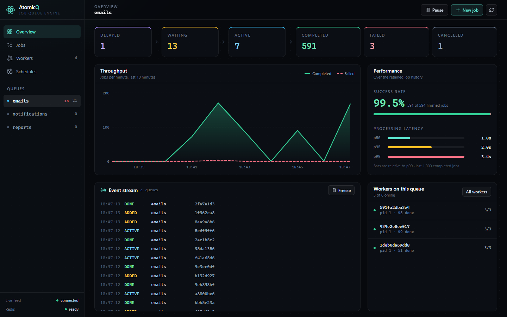
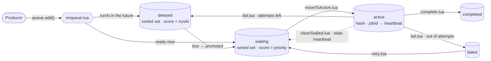
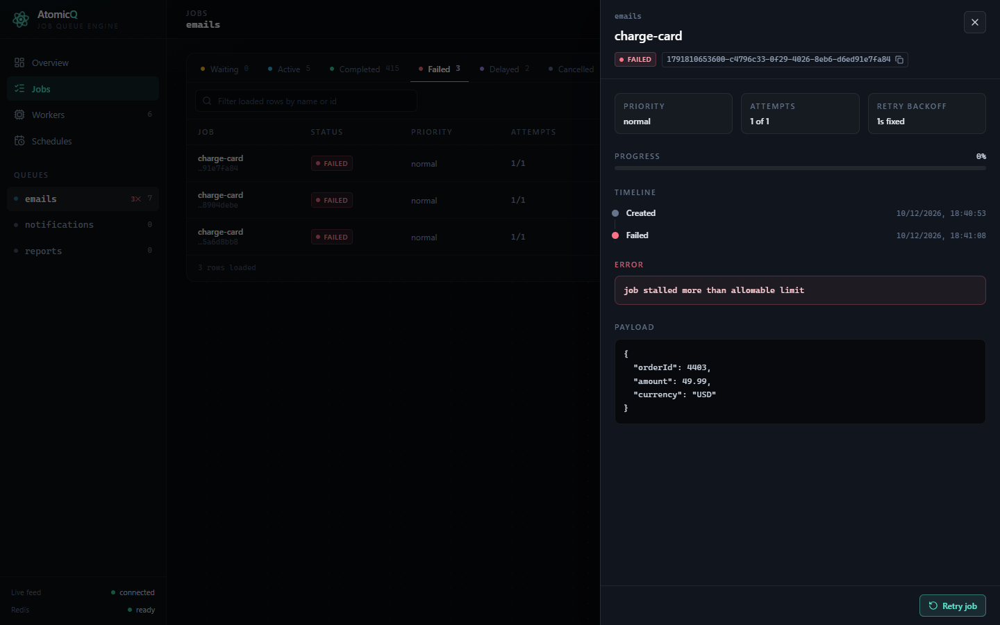
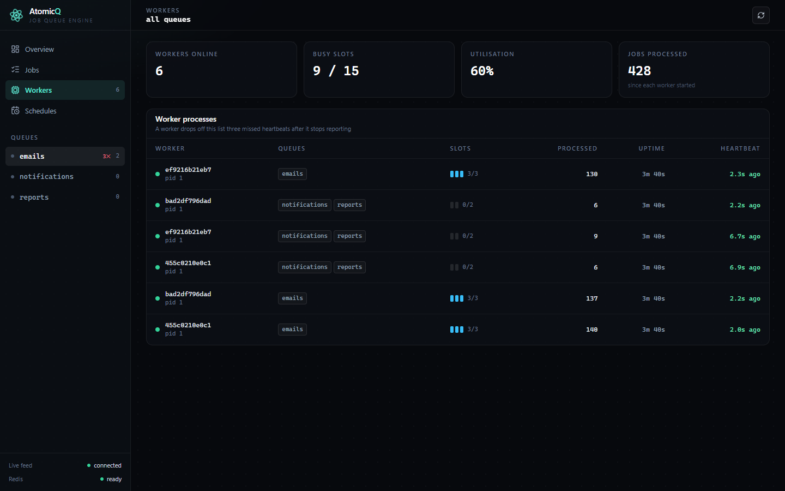

# AtomicQ

A Redis-backed job queue engine built from scratch in TypeScript — the internals of BullMQ or Sidekiq, small enough to read in an afternoon.

Every state transition a job makes (enqueue, pick-up, complete, fail, retry, cancel, stall recovery) is a single Lua script, so it is atomic in Redis: two workers can never claim the same job, and a crash can never leave a job half-moved. On top of that sit worker concurrency, heartbeats and stall recovery, retries with backoff, priorities, delayed and cron jobs, rate limiting, idempotency keys, and a real-time dashboard.



## Features

- **Atomic transitions** — one Lua script per state change; no multi-step races.
- **At-least-once delivery with lock tokens** — a worker that lost its job (cancelled or recovered as stalled) cannot complete or fail it afterwards.
- **Concurrency** — each worker runs up to `concurrency` jobs at once and can serve several queues round-robin.
- **Crash recovery** — workers heartbeat their active jobs; a watchdog returns jobs whose heartbeat went stale to `waiting`, or fails them once they are out of attempts.
- **Retries with backoff** — fixed or exponential; exhausted jobs land in the `failed` set with the error message and stack.
- **Priorities and delays** — `high` / `normal` / `low`, FIFO within a priority; delayed jobs are promoted when due.
- **Cron jobs** — repeatable definitions fired exactly once per occurrence, even with several schedulers running.
- **Rate limiting** — at most `max` job starts per `durationMs`, enforced across all workers of a queue.
- **Idempotency keys** — repeat `add()` calls with the same key within 24 h return the original job.
- **Operations** — pause/resume, cancel, retry one or all failed jobs, history cleanup, latency percentiles, graceful shutdown.
- **Dashboard** — React app fed by Redis Pub/Sub over Socket.IO: live pipeline counts, throughput, event stream, job inspector, workers, schedules.

## How it works



Each job is a Redis hash (`queue:{name}:jobs:{id}`); the sets above hold only job ids.

| Step | What happens |
| --- | --- |
| Enqueue | `enqueue.lua` writes the job hash and adds the id to `waiting` (score = priority) or `delayed` (score = run time), after checking the idempotency key. |
| Pick-up | `moveToActive.lua` checks the rate limit, promotes due delayed jobs, pops the best waiting job, stamps the worker's lock token on it and records it in `active`. One script, so only one worker gets the job. |
| Heartbeat | While a job runs, its worker refreshes the job's timestamp in `active` every `HEARTBEAT_INTERVAL_MS`. |
| Finish | `complete.lua` / `fail.lua` verify the lock token first. A failure with attempts left parks the job in `delayed` until its backoff elapses. |
| Stall recovery | The watchdog (`cleanStalled.lua`) finds `active` entries whose heartbeat is older than `STALL_THRESHOLD_MS`, counts a failed attempt, and re-queues or fails the job. |
| Events | Every transition publishes to `queue:{name}:events`; the server relays that channel to the dashboard over Socket.IO, and idle workers use it to wake up without waiting for the next poll. |

Delivery is **at-least-once**: a job whose worker dies mid-run is run again, so processors should be idempotent.

### Tech stack

| Layer | Choice | Why |
| --- | --- | --- |
| Runtime | Node.js + TypeScript (strict) | Async I/O suits I/O-bound jobs; generics type each queue's payload |
| Storage | Redis 7 | Sorted sets give ordered, O(log n) queues; single-threaded execution makes scripts atomic |
| Atomicity | Lua scripts via `ioredis.defineCommand` | Multi-key check-then-act in one step, called by SHA after the first use |
| Scheduling | `cron-parser` | Next-run calculation for repeatable jobs |
| API / live updates | Express 5 + Socket.IO | REST for state, Redis Pub/Sub relayed over one socket for events |
| Dashboard | React 19, Tailwind CSS, Vite | Small component tree; the chart is hand-written SVG, no chart library |
| Tests | Jest + Testcontainers | Real Redis per suite, no shared state, nothing to install besides Docker |
| Deployment | Docker multi-stage build + Compose | One image, roles chosen by environment variables, workers scaled by replica count |

## Quick start (Docker)

Requires Docker with Compose.

```bash
cp .env.example .env
docker compose up -d --build
```

This starts Redis, three worker containers, and one container serving the API, scheduler and dashboard.

- Dashboard: <http://localhost:3002>
- Health: <http://localhost:3002/health>

Add a job from outside and watch a worker pick it up:

```bash
curl -X POST http://localhost:3002/api/queues/emails/jobs \
  -H "Content-Type: application/json" \
  -d '{"name":"welcome-email","data":{"to":"ada@example.com"}}'
```

Scale the workers up or down:

```bash
docker compose up -d --scale worker=6
```

Measured on one laptop (Docker Desktop, the bundled `emails` worker: concurrency 3, jobs taking 50 ms–2 s), 1,000 jobs each:

| Worker containers | Concurrent slots | Time to drain | Throughput |
| --- | --- | --- | --- |
| 2 | 6 | 184 s | 5.4 jobs/s |
| 6 | 18 | 62.5 s | 16 jobs/s |

Three times the workers gave 2.95× the throughput, with the jobs split evenly across containers. Killing a worker container mid-load (`docker kill`) lost nothing: the jobs it was holding were returned to `waiting` by the watchdog once their heartbeat went stale and completed on another worker.

## Local development

Requires Node.js 20+ and a Redis 7 server.

```bash
docker run -d --name atomicq-redis -p 6379:6379 redis:7-alpine

cp .env.example .env            # then set REDIS_URL=redis://localhost:6379
npm install
npm --prefix dashboard install

npm run dev:all                 # API on :3000, dashboard dev server on :5173
```

| Script | What it does |
| --- | --- |
| `npm run dev` | API + workers + scheduler with reload on change (port 3000) |
| `npm run dev:dashboard` | Dashboard dev server, proxying `/api` and Socket.IO to port 3000 |
| `npm run dev:all` | Both of the above |
| `npm run build` | Compile the engine to `dist/` (Lua scripts included) |
| `npm run build:all` | Engine + dashboard; `npm start` then serves the built dashboard on port 3000 |
| `npm test` | Test suite (needs Docker — see [Testing](#testing)) |
| `npm run loadtest` | 10,000-job load test against `REDIS_URL` |

`.npmrc` sets `legacy-peer-deps` because `ts-jest` 29 declares a peer range that stops below TypeScript 6.

### Configuration

| Variable | Default | Meaning |
| --- | --- | --- |
| `REDIS_URL` | — (required) | Redis connection string |
| `QUEUE_DEFAULT_CONCURRENCY` | `1` | Minimum concurrency of the bundled example workers |
| `HEARTBEAT_INTERVAL_MS` | `5000` | How often a worker refreshes its active jobs' heartbeats |
| `STALL_THRESHOLD_MS` | `30000` | Heartbeat age after which a job counts as stalled |
| `SCHEDULER_POLL_MS` | `500` | How often the scheduler checks cron definitions |
| `PORT` | `3000` | HTTP port for the API and dashboard |
| `DISABLE_WORKERS` / `DISABLE_API` / `DISABLE_SCHEDULER` | `false` | Set to `true` to switch a role off in this process (used by `docker-compose.yml` to split roles across containers) |

## Using the engine

`src/server.ts` wires three example queues to demo processors. To use the engine in your own code, import from `src/index.ts`:

```ts
import Redis from 'ioredis';
import { Queue, Worker, loadScripts } from './src';

const redis = new Redis(process.env.REDIS_URL!);
await loadScripts(redis); // registers the Lua scripts on this connection — required once per client

// Producer
const emails = new Queue<{ to: string }>('emails', redis);
await emails.add('welcome', { to: 'ada@example.com' }, {
  priority: 'high',
  attempts: 5,
  backoff: { type: 'exponential', delay: 1000 },
});

// Consumer
const worker = new Worker<{ to: string }>('emails', async (job) => {
  await job.updateProgress?.(50);
  // ... do the work; throw to fail the attempt
}, redis, { concurrency: 5 });

worker.on('failed', (job, err) => console.error(job.id, err.message));
await worker.start();

// Recover jobs from crashed workers (run in at least one process)
emails.startWatchdog(15_000, 30_000);
```

### `Queue<T>`

```ts
new Queue<T>(queueName: string, redis: Redis)

add(name: string, data: T, options?: JobOptions): Promise<Job<T>>
addBulk(jobs: Array<{ name: string; data: T; options?: JobOptions }>): Promise<Job<T>[]>
getJob(jobId: string): Promise<Job<T> | null>
getJobsByStatus(status: string, start?: number, limit?: number): Promise<string[]>
getMetrics(): Promise<QueueMetrics>            // counts + p50 / p95 / p99 latency

cancel(jobId: string): Promise<boolean>
retry(jobId: string): Promise<boolean>         // failed → waiting, fresh attempt budget
retryAll(): Promise<number>
pauseQueue(): Promise<void>
resumeQueue(): Promise<void>
isPaused(): Promise<boolean>

addRepeatable(name: string, data: any, cron: string, options?: JobOptions): Promise<RepeatableJobDef>
getRepeatableJobs(): Promise<RepeatableJobDef[]>
removeRepeatable(name: string): Promise<boolean>

startWatchdog(checkIntervalMs?: number, stallTimeoutMs?: number): void
checkStalled(stallTimeoutMs: number): Promise<string[]>
startCleanup(options: CleanupOptions): void    // prune finished jobs by age and/or count
runCleanup(options: CleanupOptions): Promise<{ completed: number; failed: number; cancelled: number }>
clearCompleted(maxAgeMs?: number): Promise<number>
```

```ts
interface JobOptions {
  delay?: number;                               // ms before the job becomes ready
  priority?: 'low' | 'normal' | 'high';         // default 'normal'
  attempts?: number;                            // total tries, default 3
  backoff?: { type: 'fixed' | 'exponential'; delay: number }; // default: 1 s fixed
  idempotencyKey?: string;                      // dedupe window: 24 h
}
```

### `Worker<T>`

```ts
new Worker<T>(
  queueNames: string | string[],
  processor: (job: Job<T>) => Promise<void>,
  redis: Redis,
  options?: {
    concurrency?: number;                       // default 1
    pollInterval?: number;                      // idle poll fallback in ms, default 1000
    heartbeatInterval?: number;                 // default 15000
    rateLimit?: { max: number; durationMs: number };
  },
)

start(): Promise<void>
stop(timeoutMs?: number): Promise<boolean>      // true = drained cleanly, false = timed out
```

Events: `active`, `completed`, `failed`, `progress`, `lock_lost`, `drain_timeout`. Inside a processor, `job.updateProgress(percent)` reports progress and `job.isCancelled()` tells a long job it was cancelled.

`Scheduler` fires cron definitions, and `registerShutdownHandlers` drains workers on `SIGTERM` / `SIGINT` (30 s by default) before closing connections.

## REST API

All routes are under `/api`. `:name` is a queue name.

| Method | Path | Purpose |
| --- | --- | --- |
| `GET` | `/health` | Redis status, worker count, queue depth — `503` when Redis is down (also served at `/health`) |
| `GET` | `/queues` | Queue names |
| `GET` | `/workers` | Live workers with heartbeat, slots and jobs processed |
| `GET` | `/queues/:name/metrics` | Counts per state and latency percentiles |
| `GET` | `/queues/:name/throughput` | Completed / failed per minute, last 10 minutes |
| `GET` | `/queues/:name/jobs?status=&start=&limit=` | Page of jobs in one state (`limit` ≤ 100) |
| `GET` | `/queues/:name/jobs/:id` | One job |
| `POST` | `/queues/:name/jobs` | Add a job — body `{ name, data, options? }` |
| `POST` | `/queues/:name/jobs/:id/retry` | Re-queue a failed job |
| `DELETE` | `/queues/:name/jobs/:id` | Cancel a job |
| `POST` | `/queues/:name/retry-all` | Re-queue every failed job |
| `DELETE` | `/queues/:name/jobs/completed?maxAgeMs=` | Delete completed jobs older than `maxAgeMs` (default 1 h) |
| `POST` | `/queues/:name/cleanup` | Prune finished jobs — body `{ maxAge?, maxCount? }` |
| `GET` `POST` `DELETE` | `/queues/:name/pause` | Read / set / clear the pause flag |
| `GET` | `/queues/:name/repeatables` | Cron definitions on the queue |

## Dashboard

A React + Tailwind app in [`dashboard/`](dashboard/), served by the API server in production.

- **Overview** — the job pipeline with live counts, throughput chart, success rate and latency percentiles, and a stream of lifecycle events from every queue.
- **Jobs** — one tab per state, with retry, cancel, bulk retry and history clean-up; clicking a job opens the inspector with its timeline, error and payload.
- **Workers** — every worker process with its queues, busy slots and heartbeat health.
- **Schedules** — cron definitions and when each fires next.

| Job inspector | Workers |
| --- | --- |
|  |  |

## Testing

```bash
npm test
```

Tests run against a real Redis — Lua scripts cannot be mocked meaningfully — started per suite with [Testcontainers](https://testcontainers.com/), so Docker must be running and no local Redis is needed. They cover the queue API, worker processing and retries, idempotency, graceful shutdown (real child processes and signals), lock tokens, cancellation, cron exactly-once firing, and concurrency safety: three workers over 100 jobs with every job run exactly once, a worker process killed mid-job and recovered by the watchdog, and 50 delayed jobs coming due together.

### Load test

```bash
npm run loadtest
```

Enqueues 10,000 jobs, processes them with 3 workers × concurrency 5, and reports throughput, latency percentiles and Redis memory. One run on a Windows 11 laptop with Redis in Docker Desktop: enqueue 0.74 s (~13,500 jobs/s), processing 14.5 s (~690 jobs/s), 0 failures.

## Project layout

```
src/
  Queue.ts        producer API, metrics, watchdog, cleanup, cron registration
  Worker.ts       fetch loop, concurrency, heartbeats, lock handling
  Scheduler.ts    fires due cron definitions
  api.ts          REST router
  server.ts       example app: queues, workers, API, Socket.IO relay
  shutdown.ts     graceful shutdown on SIGTERM / SIGINT
  scripts.ts      loads lua/*.lua as Redis commands
  keys.ts         Redis key layout
  lua/            one script per state transition
dashboard/        React dashboard
tests/            Jest suites (Testcontainers)
scripts/          load test, benchmark and helper scripts
```

## License

MIT
